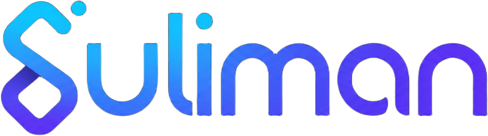

  

  <b>AI Engineering | Software Engineering</b>

  
  
  

## About

I build applied AI tools, Python backends, and automated tests. My repositories cover Arabic NLP, retrieval, agentic workflows, and web test automation.

## Featured Projects

### [BALAGH | بلاغ](https://github.com/vc2zx/BALAGH)
Arabic-first local research prototype for report intake, model proposals, retrieval, and staff review. Flask and SQLite power the current application; separate LangGraph workflows use in-memory checkpoints. Human staff control decisions. Exact category-set matching improved from **47% (rules baseline) to 81% (semantic approach)** on 36 author-labelled synthetic Arabic cases.

[Evaluation](https://github.com/vc2zx/BALAGH/blob/main/docs/EVALUATION.md) · [CI](https://github.com/vc2zx/BALAGH/actions/workflows/unit-tests.yml)

### [OPINION.AI](https://github.com/vc2zx/OPINION.Ai)
Flask and SQLite review-analysis prototype using TF-IDF and Logistic Regression, with a dashboard and CSV export. Trained on small controlled datasets.

### [Cypress Web Automation Assessment](https://github.com/vc2zx/Suliman-Altayar-Cypress-Automation)
Training suite for The Garage and Satr: 14 unique E2E cases. Recorded assessment result: **14 passed, 0 failed**.

### [Raqib — Fraud Scoring Service](https://github.com/vc2zx/sda-aie-113-fraud-service)
Instructor-supplied SDAIA course work covering FastAPI, layered architecture, tests, Docker, and CI/CD.

BAYYIN is an unpublished personal evidence-review prototype; details are on my [portfolio](https://vc2zx.github.io/#projects).

## Technical Stack

**Programming & Backend**

  
  
  
  
  

**AI & Machine Learning**

  
  
  
  
  

**QA & Testing**

  
  
  
  

**Development Tools**

  
  
  

## Connect

  <a href="https://vc2zx.github.io/">Portfolio</a>
  &nbsp;•&nbsp;
  <a href="https://www.linkedin.com/in/sulimanksa/">LinkedIn</a>
  &nbsp;•&nbsp;
  <a href="mailto:Suliman.A.AlTayar@gmail.com">Email</a>

  

